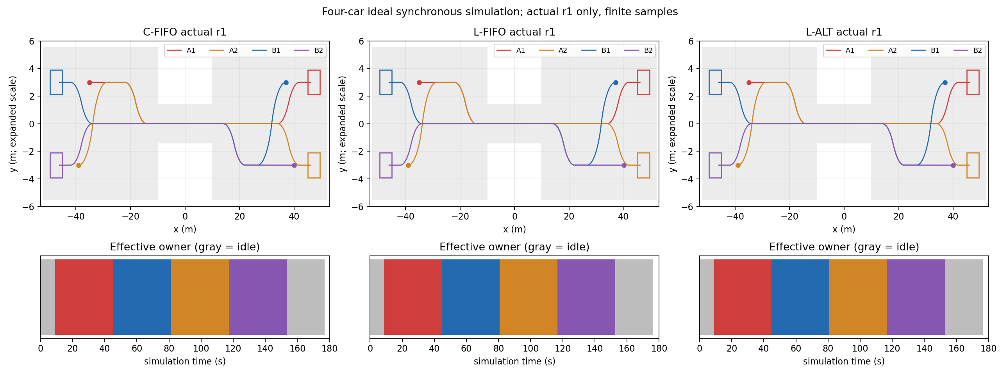

# M2b：四车理想同步通信真实实验

六次正式运行完整验收全通过：**True**。逐轮结果见comparison.csv、metrics.json和各运行independent_validation.json；失败不改报成功，未运行的组不算通过。

|运行|完整验收|完成s|最小采样净空m|最大周期ms|工件MiB|授权顺序|失败|
|---|---|---|---|---|---|---|---|
|C-FIFO/r1|True|177.0|1.1999982805744354|1449.7|45.22|['A1', 'B1', 'A2', 'B2']|None|
|C-FIFO/r2|True|177.0|1.1999982805744354|1811.9|45.22|['A1', 'B1', 'A2', 'B2']|None|
|L-FIFO/r1|True|176.4|1.1999980698173731|1233.8|46.74|['A1', 'B1', 'A2', 'B2']|None|
|L-FIFO/r2|True|176.4|1.1999980698173731|1936.5|46.74|['A1', 'B1', 'A2', 'B2']|None|
|L-ALT/r1|True|176.4|1.1999980698173731|1365.7|46.75|['A1', 'B1', 'A2', 'B2']|None|
|L-ALT/r2|True|176.4|1.1999980698173731|2079.1|46.75|['A1', 'B1', 'A2', 'B2']|None|

固定初态/目标严格采用任务书；中央窄通道不变，外侧道路显式扩至abs(x)=52 m。等待点为左(-22,+3)/(-28,+3)，右(+22,-3)/(+28,-3)。每车的本地曲率原语、转角停车转换及最终车位均独立；同侧尾车先等前车实际到队首再合流，前车旋转车身离开队首区域后才补位。DONE车一直保留真实车身，全部6车对在321点最终预测和全部实际样本中检查。

控制沿用五状态、N32/h0.2/sample0.02、原目标/物理/模型误差阈值、OSQP参数、原权重、单步导数与最多3次更新。保留停车首输入修复并全重验。调试发现上一周期允许形成后续一控制步停车越过路径数值界的状态；新增首输入后的必要停车距离s1+h*v1/2不超过段端点的可达性行（数值带补偿，不放宽任何门限）。只作用于实际即将提交前缀，未把状态/速度覆盖为零。详细变更与调试反例见design.md及debug目录。

集中式真正单次组装/优化128参考和256自行车输入变量；参考层分块目标和本车行同时在一个QP求解，自行车层装配6对联合变量耦合行。局部每车只求32/64变量，自身Agent/目标/缓存，另三车由真实ROS2消息取得公开状态和预测。按A1→B1→A2→B2固定一轮，读取已更新最终计划/未更新种子；局部禁用中央入口和旧联合方法，无救场。两臂使用相同路线、道路/权限/分离几何，但参考分块单次与局部依次求解、联合/固定邻车耦合、预算作用域不同，不是等算力或同一数学问题的纯架构因果实验。

M2b-release-v1以实际旋转车身最小方向x>=26.5 m核查释放，初次授予及交接均经过四车同版本条件候选/认可后才生效；无合格下一队首允许owner归None。请求首次周期保留，资格只从已请求且实际停在队首、转向就绪的同侧队首选取。FIFO-ready与alternating-ready只改变选择规则，后者仅在实际授予时更新方向历史。单车独占，无批次、无在线中央全未来门禁或备用。

真实五个ROS2节点（同进程）、可靠DDS、理想同步无注入延迟，计算期间仿真时钟冻结。0.5 s是每次本车预测调用或中央一次四车调用，四车顺序总预算不同；端到端包括参考/求解/修复/消息/认可/提交，输出导出及离线审计单列。消息字节为原完整应用JSON信封，不是压缩存储字节，不含网络头；分项无法完全分离处保留组合口径，不虚构纯通信耗时。在线/离线时间及每车/联合QP、变量、迭代、更新、修复、误差、请求/就绪等待、进入、空闲原因、停走和工程存储见metrics.json。

日志使用无损gzip和单份计划ID引用；完整final321节点保留，seed相同前缀引用前周期已提交final并保存新增10点尾部，恢复原ID及逐浮点内容。消息引用计划正文，原应用字节和浮点精度不变。正常周期不保存QP矩阵/冗余行全细节；失败及前两周期、交接/输入修复及邻接周期保存诊断。无穷矩阵界显式编码为Infinity/-Infinity字符串以保持JSON可读且不污染有限物理数值。代码按内容版本在sources/保存一份，每轮只引用版本，六次均保留自己的实际、事件、消息时间及计时。工件30 MiB/总200 MiB为软目标，超过时最大文件和原因列明，不删物理/协议证据凑数。

验收独立标量两半步RK4重积分每个实际间隔及全累计、全部最终预测，重建首次请求、独立就绪/选车、清空/授权/进入、四最终ID与四ACK/提交、信息来源及全部出口计时。旋转矩形几何复用M1库，未宣称完全独立几何实现；summary的true不替代验收。未新增四车中央完整未来诊断，不将其当成局部未来证明。

两次重复只核查确定性；授权顺序打平是本场景结果，不修改初态制造差异。未实现六车、同向批次、额外延迟、在线备用，未证明连续安全、递归可行、硬实时、实车可靠或持续到车无饥饿。

复现先source /opt/ros/jazzy/setup.bash，OPENBLAS_NUM_THREADS=1、PYTHONPATH=/tmp/t1_qp_deps:$PYTHONPATH、ROS_LOG_DIR=/tmp/m2b_ros；依赖版本和每组精确命令见environment.json。run_m2b.py --check-scene；--arm central/local --policy fifo-ready/alternating-ready --repeat 2 --output 新目录。随后verify_m2b.py --run 总包、report_m2b.py --run 总包。不得覆盖已存在输出。

完整周期口径：comparison.csv及汇总cycle_s采用相邻周期实际开始时刻之差，覆盖提交后的精简记录、关键诊断整理和进度输出；原开始至提交结束计时保留为logged_commit_end字段。最后一个无输入完成出口单列，详见timing_scope_supplement.json。


## 最终交付复核

六次正式运行均完成并独立验收通过。32项交付测试通过（冻结前30项，另加无损诊断恢复/损坏拒绝及“输入修复后重算ID但未重预测”2项边界检查）；归档续做回归亦通过。种子前缀/尾部补充重演六轮均通过，最大差7.11e-14。原M1物理核心及原控制器文件哈希未变；旧34项M1回归只复用冻结证据，不冒充本轮新跑。

两种局部调度顺序相同：True，均为A1→B1→A2→B2；L-FIFO与L-ALT均176.4 s，各组两次实际轨迹逐字节一致。本场景未区分出调度收益，不调整初态制造赢家。后续可另设同侧先集中就绪、异侧后到达序列，本轮未执行。

完整提交周期采用相邻启动时刻实测间隔，包含提交后的精简记录、关键诊断整理及进度输出；原在线开始至提交结束计时保留为logged_commit_end字段。最后无输入的完成出口单列。所有实际提交周期均超过200 ms；不满足硬实时。

|运行|P50 ms|P95 ms|P99 ms|最大 ms|超过200 ms周期|
|---|---|---|---|---|---|
|C-FIFO/r1|629.4|792.0|1074.9|1449.7|885|
|C-FIFO/r2|625.3|807.1|1103.2|1811.9|885|
|L-FIFO/r1|650.1|725.9|913.0|1233.8|882|
|L-FIFO/r2|653.1|733.1|990.8|1936.5|882|
|L-ALT/r1|669.7|744.1|952.6|1365.7|882|
|L-ALT/r2|671.6|747.0|1054.2|2079.1|882|

控制执行代价为统一的输入平方积分Σh(a²+ω²)，不是QP总目标，也不直接最小化任务时间。中央/局部的变量与耦合表达、预算作用域、消息认可工作量不同，不作等算力或纯架构因果结论。详细每车完成、端点误差、排队/许可等待、停走/补位、QP迭代/更新/修复/误差、通信字节和在线/离线成本见metrics.json。

原独立工件每轮约45–47 MiB，大于30 MiB软目标；最大项是交接、停车修复及其必要邻接周期的完整诊断约23–24 MiB，其次为完整最终321节点及可恢复种子的计划约19 MiB。未为达标删除矩阵或降低精度。后处理按字节相同的计划gzip文件硬链接共享，并把重复QP _details正文在diagnostic_objects/按内容ID保存一份；748个数值正文均可恢复，各诊断完整原JSONL字节SHA256逐轮一致。接续时先重验4份已完成归档，再完成余下2份，未重跑控制。所有验收实际输入、计划、协议和验收文件字节保持不变，见archival_input_integrity.json；其哈希基线时间及范围明确标注，不冒充最初运行时哈希。

共享存储唯一文件数据约182.39 MiB，表观路径大小约294.11 MiB；200 MiB软目标：True。共享对象需随全包交付；展开硬链接复制会回涨，不能把只含引用的单轮目录当独立完整小包。原始、仅gzip及引用gzip的逐轮实测见storage_measurements.json，节省不直接相加。存储操作均在线结束后执行，不算在线求解提速。

恢复完整诊断正文（输出必须是新目录）：

```bash
python3 examples/head_on_mpc/scripts/m2b_diagnostic_archive.py --run examples/head_on_mpc/results/M2b_fourcar_001 --restore-to /tmp/M2b_full_diagnostics
```

正常实际/协议验收可直接读取gzip和计划引用；完整诊断恢复还需要全包diagnostic_objects。正式源码按版本在sources/只存一份；补充种子/时序/存储与归档检查源码在analysis_source/另有哈希，不属于冻结控制算法的新版本。debug_v1 cycle43、debug_v2 cycle33、debug_c1 cycle689反例均保留；debug_v3完整运动通过但其早期诊断导出失败的身份亦保留，不替代正式六轮完整交付。



未实施六车、批次、额外延迟、在线备用或四车中央全未来诊断。有限采样、理想同步通信、两次确定性重复不证明连续安全、递归可行、延迟鲁棒、硬实时、实车可靠或持续到车无饥饿。计算期间状态冻结，停止离线仿真不是安全停车。

归档接续补记：中断后发现21个空对象和2份空索引，原损坏文件保留于interrupted_archive_files/。对象仅从仍完整的L-ALT诊断中按原内容ID精确恢复；2份索引的摘要按完整引用记录重建并注明原先的恢复比较日志作为出处，不冒充原摘要文本仍在。逐来源见archive_checkpoint_recovery.json；恢复未运行优化器，实际/计划/协议输入未变。

归档与环境恢复详见environment_restore.md；包内verify_artifact_hashes.py可脱离ROS/数值依赖核对文件与数值对象内容ID。

分发包位于同级M2b_fourcar_001.tar.gz（保留计划硬链接），对应receipt.json记录实际大小、SHA256和逐成员回读校验；恢复及完整性检查使用environment_restore.md中的入口。
