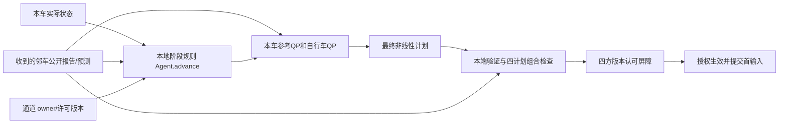

# 第一阶段：疑问、事实与处理

本轮以维护目录 `examples/head_on_mpc/scripts/` 为修改入口；历史 `M2b_fourcar_001` 不写入。以下定位均为该维护目录的文件/函数；原表来自历史 comparison.csv、metrics.json、design.md 和各轮独立验收，不将交接中的假说当成新测量。

|疑问|代码/记录事实与解释|本轮处理|
|---|---|---|
|为什么同一场景两次？|六轮记录完成且独立验收通过；四次局部的实际结果一致。它验证确定性并提供初步墙钟波动，不是多场景成功率。|保留历史锚点；本轮小型配对后只加一次完整L-FIFO回归。|
|轨迹相同为何墙钟不同？|L-FIFO两轮在线583.6205/588.2564秒，仿真均176.4秒。计算期间时钟冻结，二者独立。历史没有足以归因具体波动的CPU调度/负载轨迹。|新增资源取样；不把历史差值直接归为网络或某CPU因素。|
|代价是什么？|report_m2b.metrics 的 `control_cost=h*sum(a²+omega²)`，从实际首输入累加。优化目标在 m2b_control.reference_qp / bicycle_qp，另含进度、速度、状态和输入变化。|报告明确为输入平方积分代理；不是总QP目标、任务时间或实测能耗。|
|P50高、P95低？|历史 C-FIFO/r1 P50=629.37ms、P95=791.99ms；L-FIFO/r1为650.13/725.90ms，最大值也并非稳定改善。|新结果分列P50/P95/P99/最大/超200ms比例；不只挑有利分位。|
|中央/局部公平吗？|同车型、道路、初态、目标与验收。中央128参考/256自行车变量；本车32/64。局部按ORDER使用已更新final或未更新seed；中央同时优化四车。预算、分离行与认可开销也不同。|只能比较这些实现的结果，不能作同QP/同算力的纯架构因果归因。|
|0.5秒约束谁？|Optimizer.predict 每次 `started+DEADLINE_S`；中央整次四车共用0.5秒，局部四次各有0.5秒。构造和非线性重验后还检查总elapsed。|保持预算；完整周期200ms另算，分别报告本车deadline与整周期超期。|
|局部并行吗？|run_m2b.online `sequence=ORDER`，逐车candidate后发送final，后车看到本轮前车final；不是计时误加。|第一阶段保持。第二阶段须改成同轮信息快照和真实并发，不能取旧耗时最大值充数。|
|信息交换为何慢？|Wire.send 每条publish后wait；同一topic有五个订阅，每个receive都先json.loads，再判断receiver。observe_plan会重积分；原ACK又重验同一计划。|分别计编码/解码、投递等待、复制、积分、几何；本轮只优化本端重复单计划验证。逐条交换与广播冗余仍待第二阶段处理。|
|349.56/178.72ms是什么？|它们是旧运行事件边界下的剩余/认可时段，非纯网络。旧数据缺内部调用时钟，不能倒推各项。|新增真实末次final与首次commit边界，嵌套计时同时给exclusive类别；新小样本不冒充旧882周期分解。|
|合流/补位由谁决定？|Agent.advance 读取前车公开 queue_arrived/left_queue，并推进本车预设阶段；Optimizer只对本车当前阶段求输入；Channel负责请求/owner/版本。|属于本地规则+局部优化，不声称QP自主发现合流触发。|
|为何换曲率先停车？|build_routes 按固定delta分段；Agent.advance 到段端且实际速度足够低才进入STEER；STEER用现有转角速度原语。bicycle_core.derivative已有v和delta的耦合动力学及a/omega输入。|是当前参考/阶段限制，非模型缺少转向。第一阶段保持这一运动结构。|
|能否连续调速度和转角？|可作为新运动分支；kappa=tan(delta)/L，转角与半径关联。现 corridors、target、trust box、stop_index 同时依赖固定路段。|已读取指定原文，另存方法边界；尚未实现或验证连续转向，不把无停车参考当成已可行控制器。|
|停车QP为什么失败？|正式设计保留debug反例：首步后必要最小停止距离h*v/2缺口约1.7e-7m；当前bicycle_qp仅K>1时增加首步停车可达性行。首输入修复后仍检查仿射和非线性。|现有冻结停车回归实际通过；不扩大max_iter、不重置状态、不提前WAIT。|
|两种调度为何打平？|历史交接cycle44/224/404/584选择A1/B1/A2/B2。cycle224候选A2、B1；FIFO的先请求者与交替的异侧车同为B1。cycle404同理选A2。|解释实际事件；不把一致结果说成调度普遍等效。分歧场景属后续独立问题。|
|文件变小能否在线更快？|m2b_recording.export在在线后导出；messages按计划ID引用，Wire仍发送稠密正文。|存储、应用字节与控制周期分列，未把压缩收益称求解提速。|
|token为什么高？|已有M2b_token_audit_001：主38,128,258、guardian6,443,952，缓存含于输入。长上下文多次模型往返是实证；数值程序未见LLM路径。|直接复用原审计。短hook配对另见token_hook_ab_001，合计增416而非节省；本轮不重新审计或虚构用量。|

验证缓存仅在本车端点内复用已有单计划检查；它不生成运动、不共享另一车优化缓存、不替代组合检查或中央救场。
