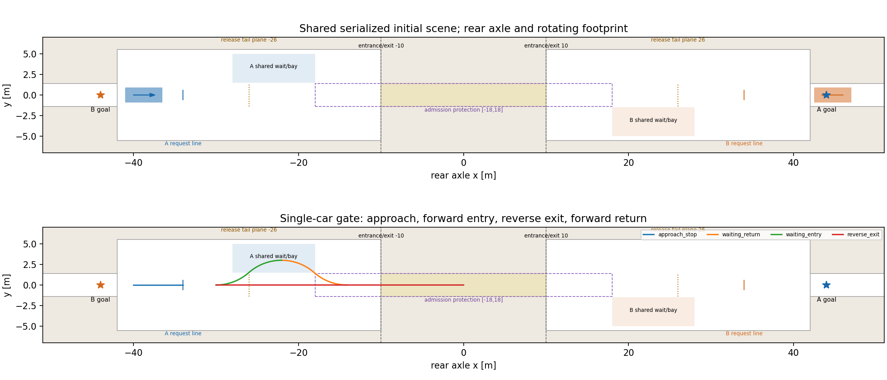
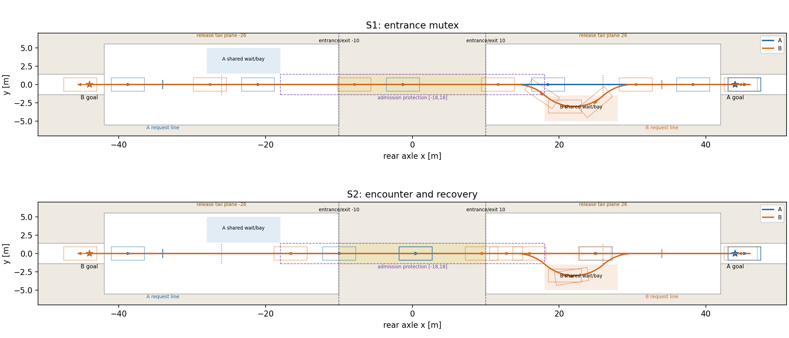
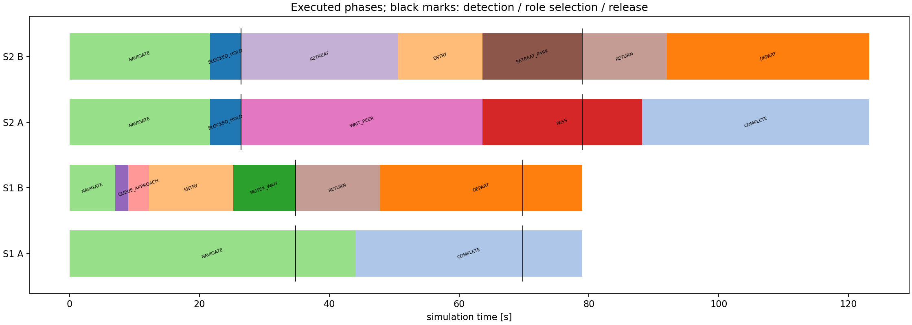
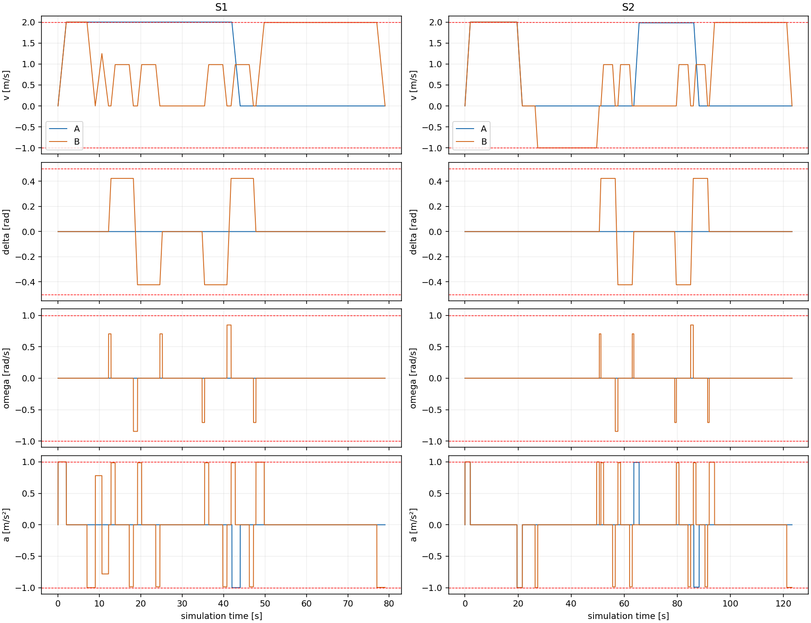
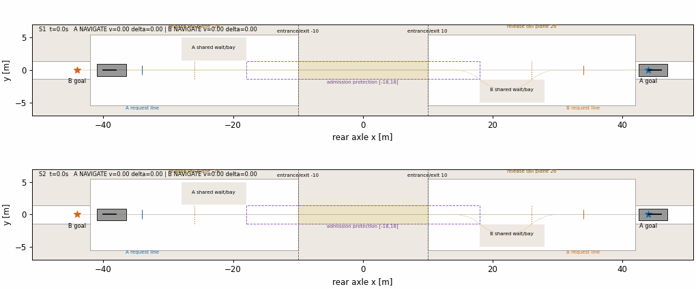

# 双车单通道：入口互斥预防 vs 相遇后恢复（单组离线实测）

实验使用同一份序列化物理场景、同构车辆与共同底层控制；两辆车各自的原目标在S1/S2完全一致。只运行A近、B远这一组，不作泛化成功率推断。

## 方法、地图与适用范围

执行模型为以后轴为参考的五状态运动学自行车，RK4逐0.02 s积分；控制0.2 s，预测32步。带转角、转角速率、速度和加减速约束。车身为前悬0.8、轴距2.7、后悬1.0 m的旋转矩形。最小转弯半径约4.942 m，入位圆弧选6 m。参数来源及全部具体数值见[变量表](variables.md)。没有轮胎侧偏动力学、实车标定或换挡停顿。

共同控制采用停车—受限转向—圆弧行驶的运动原语，加速度梯形时标按实际距离生成。没有预设y日程、状态覆盖或独立横移。不调用旧纵向QP；这是替换执行模型所需的最小确定性控制入口，不是新的DMPC控制器。加速度允许分段变化，本轮没有jerk约束。

原make_scene地图上的同类圆弧入位被道路车身验收拒绝，证据保存在single_vehicle/original_map_rejected_maneuver.json及CSV。该结果只证明所测机动失败，没有穷尽搜索，不能推断原地图物理不可达。新公共地图另存为scene.json：保留20×2.8 m通道，在两端增加明确对称的转弯区，两策略共享；结果只适用于此地图。旧地图与历史结果均未覆盖。

S1在后轴通过±34 m申请线时原子申请唯一owner，申请时间、ID排序；未获许可者先制动，再驶到后轴±30 m入位起点，依自行车圆弧停车在旁侧等待区。准入保护区为主路x∈[−18,18]；外部合流通过额外释放保护覆盖：通过车尾缘清空±26 m并加0.5 m裕度，同时完整重演双方余下机动至各自目标，才释放。之后双方执行该见证轨迹并停在不同目标，不将有限预测时域无碰撞当作永久安全。

S2正常阶段将相向车头间可用纵向空间平均分配为双方制动约束，前进目标仍为原任务；实际运动在0.6 m车头净距处停住，名义安全阈值0.5 m不变。此共享配对安全过滤是确定性控制假设，不是DMPC上一预测交换求解。只在有当前验收预测时调用旧BlockingDetector；正常停车不强制触发，持续停滞与车挡证据形成后才选角。双候选从同一真实检查点完整退出，排序沿用E3/E4的退出时间、倒车距离、ID规则。旧E3/E4的EXIT→PASS→RELEASE→RETURN阶段语义保留，旧横移数值执行和E4求解保护未直接调用；新释放改用双方完整未来轨迹见证。

这是离线仿真：候选期间模拟时间冻结，selection_wait_wall_s单列。主规划为原语与轨迹生成，优化求解器调用数为0；不把它虚报为QP求解。协议消息为单进程内按compact UTF-8 JSON编码的估计，含双方发给管理端的当前预测及管理端角色消息，不代表真实网络流量。S1只交换许可协议，不为统一成本发送预测。该通信表依赖本入口采用的逻辑协议；理想单进程可访问完整状态、确定性计划及地图，未统计实车感知和状态估计通信，不能把消息差异视为策略必然的带宽差异。

## 逐策略实测

|策略|状态|双方完成模拟s|A完成s|B完成s|总路程m|倒车m|静止等待车秒|策略进程墙钟s|候选墙钟s|
|---|---|---:|---:|---:|---:|---:|---:|---:|---:|
|S1|both_completed|79.0|44.0|79.0|175.471|0.000|14.340|5.699|0.000|
|S2|both_completed|123.20|88.20|123.20|221.871|23.200|66.840|9.309|0.223|

|策略/车|二维距离m|纵向累计m|倒车m|互斥排队静止s|互阻检测静止s|退让停驻s|恢复中对方保持s|机动转向静止s|等待区占用s|
|---|---:|---:|---:|---:|---:|---:|---:|---:|---:|
|S1/A|84.000|84.000|0.000|0.00|0.00|0.00|0.00|0.00|0.00|
|S1/B|91.471|90.000|0.000|9.70|0.00|0.00|0.00|4.64|29.14|
|S2/A|84.000|84.000|0.000|0.00|4.80|0.00|37.20|0.00|0.00|
|S2/B|137.871|136.400|23.200|0.00|4.80|15.40|0.00|4.64|34.94|

等待统计仅在|v|≤0.025 m/s时按互斥阶段互斥分类；入位和返回的转向停车单列为机动转向静止，行驶阶段不计静止等待；逐阶段原始静止时间另存recomputed_metrics.json，已完成车辆在终点保持不计等待。车秒为两车求和，不等于总工期。占用统计每0.02 s检查旋转车身与固定等待区相交，属于物理占用，与策略资源保留分别报告；未作不同量纲加权总分。

|策略|最小实际净空m|最小预测净空m|通道实际有车s|通道许可保留s|消息数|估计payload bytes|
|---|---:|---:|---:|---:|---:|---:|
|S1|1.200000000|1.200000000|24.74|65.80|10|809|
|S2|0.600000000|0.600000000|68.80|0.00|1236|3086588|

S2没有许可锁，因此许可保留时间为0；其通道物理占用和互阻检测等待均非零，不能称为空间成本为零。净空采用有向矩形SAT重叠判断和边段欧氏最短距离；道路按矩形并集与车身多边形裁剪面积检查，跨接缝不只查角点。道路残差单位m²，其余速度/输入/角度残差保留原单位；数值容差1e−5。安全只经过0.02 s加密采样，未建立连续时间安全证明。

## 阶段事件与计算

|策略|事件|车辆/角色|模拟s|
|---|---|---|---:|
|S1|request|A|4.00|
|S1|grant|A|4.00|
|S1|request|B|7.00|
|S1|deny|B|7.00|
|S1|waiting_ready|B|25.20|
|S1|release|A|34.80|
|S1|request|B|34.80|
|S1|grant|B|34.80|
|S1|return_started|B|34.80|
|S1|car_completed|A|44.00|
|S1|release|B|69.80|
|S1|car_completed|B|79.00|
|S1|both_tasks_completed||79.00|
|S2|mutual_blocking_detected||26.40|
|S2|role_selected|B|26.40|
|S2|exit_complete|B|63.60|
|S2|pass_started|A|63.60|
|S2|release|A|79.00|
|S2|return_started|B|79.00|
|S2|car_completed|A|88.20|
|S2|car_completed|B|123.20|
|S2|both_tasks_completed||123.20|

|策略|计算分项|次数|合计墙钟s|平均s|最大s|超过h次数|
|---|---|---:|---:|---:|---:|---:|
|S1|main_planning|395|4.6533|0.011780|0.112015|0|
|S1|cycle_total|395|5.5262|0.013990|0.113945|0|
|S1|diagnostic|792|0.8385|0.001059|0.080014|0|
|S2|main_planning|616|7.3731|0.011969|0.124858|0|
|S2|cycle_total|616|9.0231|0.014648|0.249260|1|
|S2|diagnostic|1234|1.2884|0.001044|0.093137|0|
|S2|candidate|2|0.2216|0.110798|0.111054|0|

cycle_total包含对应周期计算；候选选择和诊断可能包含在周期总墙钟中，各行不能重复相加。主规划统计为轨迹构造/滚动预测，包含切换时的完整未来见证计算；诊断分项也记录该见证，不能与主规划相加；首次公共运动计划构造耗时另见summary。全部被拒候选也进入候选统计；优化调用、重试均为0。独立重读验收、作图和动画另计进程总墙钟，不计模拟完成时间。

## 实测解释

实际车身首次进入通道：S1: A=14.26s，B=48.94s；S2: A=14.26s，B=17.26s。A均先到。

本组成功配对：S1完成更快；S2−S1=44.200模拟秒。S1=1/1、S2=1/1，均为这一固定场景的完成结果，不是泛化成功率。
机制解释属于基于轨迹的推断：S1提前让后到车辆驶入等待区；S2先进入通道、停滞检测，再倒车退出到同一个等待入位点，增加了通道占用、倒车路程和检测等待。两者后续都执行同样的圆弧入位/返回和原目标终端口径。该单组中若S1更快，应将S2定位为未预防互阻时付出更高代价的恢复方案；结果不支持DMPC优越性结论，也没有异构、多参数或交换到达顺序的证据。

## 验收与复现

独立重读验收总结果：True。实际与预测均重放五个运动分量；复查输入界、换向零点、车身尺寸、道路、净空、时间连续、两策略初态配置、许可/释放、候选检查点、完整返回及双方原目标。详细残差与指标重算见validation.json；单车四项结果见single_vehicle/checks.json。







在examples/head_on_mpc目录运行（输出目录必须不存在）：

```bash
OPENBLAS_NUM_THREADS=1 python3 -m unittest discover -s tests -p test_entry_bicycle.py -v
OPENBLAS_NUM_THREADS=1 python3 scripts/run_entry_bicycle.py --output results/entry_bicycle_rerun
OPENBLAS_NUM_THREADS=1 python3 scripts/verify_entry_bicycle.py --run results/entry_bicycle_rerun
```

未检查：连续时间安全证明、轮胎侧偏、真实网络与实时调度、实车跟踪误差。风险：控制采用停车切换曲率的保守运动原语，地图已明确拓宽；结论限于该配置和该共同控制器。

## 计时补充与源码版本

两条主运行及初始日志管线墙钟 15.217 s。首轮完整流程（含独立验收、作图和动画）工件时间戳跨度约 79.965 s；首轮末尾未保存单调进程计时，故此值明确为近似，不冒充精确进程剖析。本次最终后处理进程单调墙钟 60.222 s，其中独立重读验收 32.158 s、绘图动画 28.060 s。未来入口已补齐末尾精确总流程计时。

主运行实际执行源码快照和哈希保存在source/及provenance.json；后处理及输入边界校验补全版本保存在final_source/及finalization_provenance.json。仅做了两条主运行，后续独立验收与作图重读已有轨迹，没有额外配对样本，也没有修改轨迹。详细等待区与机动位姿坐标见geometry.json。

最后仅补充图上保护区与申请/释放线标注，另一次图文导出墙钟 31.895 s；未追加主仿真。

最终补充：候选预演日志的相对时钟已显式映射到检测检查点126.4 s，原始时钟文件另存actual_original_preview_clock.csv，映射见candidate_clock_correction.json；车辆状态、输入和正式轨迹均未改动。11项测试和最后一次独立验收均通过。
