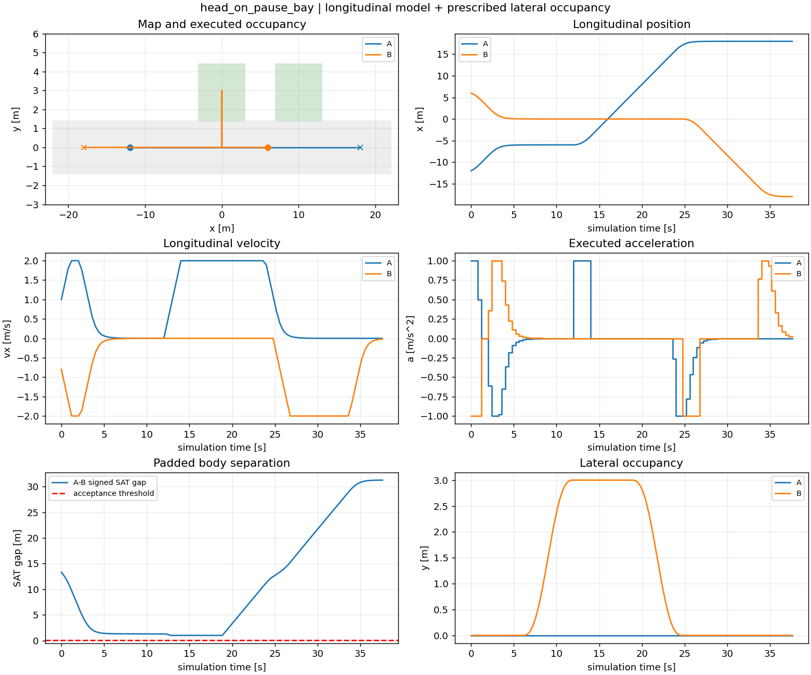
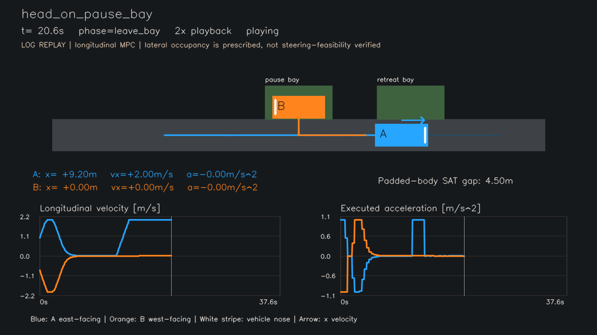

# 一次模拟日志总结：head_on_pause_bay

生成时间：2026-10-16T18:17:57.683589+08:00。本目录中的数据、图片、视频和RViz回放使用同一份执行日志。

## 1. 提交版本

上游提交 `2d5f84f225899ae4b749cb2c851bfdbed86a9642`；本提取目录尚待用户最终提交。不能把上游提交号当作新案例已提交的证明。执行源码指纹 `685582862f5834ab7ada58cd53a80113cfe05fb227dcb135ad8ecffb810f8183`，逐文件哈希见 [provenance.json](../provenance.json)；完整源码随本案例目录进入Git版本控制，不再复制无关项目源码。

## 2. 地图与初始条件

主通道x∈[-22,22]m、y∈[-1.4,1.4]m；旁侧暂停区x∈[-3,3]m，入口退让区x∈[7,13]m，两区上界y=4.4m。矩形车身含余量，长4.7m、宽2.0m，状态原点为车身中心。

A初始(x,vx)=(-12,1)，朝东；B初始(6,-0.8)，朝西。A/B目标位置分别为18/-18m。A等待线x=-6m；暂停位置x=0m；倒车前制动目标x=5.4m；后退目标x=10m。精确配置见 [config.json](config.json)。

## 3. 控制周期、模型与约束

控制周期0.4s、预测16步/6.4s；模型和执行约束采样间隔0.1s。采用精确零阶保持纵向双积分，优化变量为每步加速度，仅执行第一项。

代价：0.6×位置误差平方和 + 0.4×速度平方和 + 0.15×加速度平方和 + 0.2×加速度变化平方和，变化相对于上一实际控制；统一缩放不改变最优解。SLSQP使用解析梯度，速度绝对值≤2m/s、加速度绝对值≤1m/s²，同道预测中心间距≥5.2m，另检查目标不越界与方向。执行时独立检查矩形车身间隙、道路和纵向限制；验收间隙≥0.08m，数值容差1e-5。

高层规则指定A优先与本次策略。旁侧进出用6秒五次平滑横向占用变化，**未验证自行车转向可达性**。本例不是自主策略选择、连续时间安全证明或实车实验。

## 4. 通信设置

进程内同步双向预测交换，每轮冻结上一轮数据；正常包龄0.4s，初始包龄0。字段为时间戳、绝对时间数组、x/vx/y预测；尾部补一个周期零加速度。无丢包、延迟抖动或周期内反复协调。这里是离线求解的仿真通信，不是ROS实车通信。ROS只用于后处理回放。

## 5. 原始日志与图片

本次结果 **completed**；仿真时长37.6s；到达时间{'A': 27.6, 'B': 37.6}；最小采样SAT间隙1.000000m；B倒车0.000m；最大执行采样违背8.43e-13；求解188次，拒绝0次。

`blocked`表示本规则和观察时间内未完成任务，不代表通行成功或一般不可行性证明。耗时依机器变化，不能由本例证明实时性。

[执行状态 actual.csv](actual.csv) · [全部控制与求解记录 solves.json](solves.json) · [预测交换 predictions.jsonl](predictions.jsonl) · [模式事件 events.json](events.json) · [摘要 summary.json](summary.json)



## 6. RViz2 案例回放

按项目[README](../../../README.md)独立构建后运行：

```bash
ros2 launch head_on_mpc replay.launch.py case:=head_on_pause_bay
```

默认加载随包安装的本次结果，也可用`study_dir:=/absolute/path/to/run_001`指定结果目录。`playback_rate:=2.0`双倍速，`loop:=false`停留最终帧。显示地图、车辆、车头方向、已执行/预测轨迹和阶段。真实ROS发布/订阅验证通过，三种策略最终车辆位置与原始日志一致，收到相机TF。 当前环境无桌面显示，未将消息验证表述为已验证GUI渲染画面。

## 7. 可播放视频

[打开或下载H.264 MP4](replay.mp4)：1280×720、20fps、2倍速，视频20.85s，其中包含结尾停留。编码后逐帧解码417帧，核验记录见 [video.json](video.json)。视频从原始日志绘制，**不是RViz录屏**；它与RViz共用`recording.py`读取状态，横向抽象与实验一致。

[](replay.mp4)

## 验证与完整性

离线测试退出码：0，见 [测试日志](../tests.log)。本包原始文件校验见 [manifest.json](../manifest.json)，可执行`python3 scripts/verify_bundle.py`独立检查源码/工件哈希、动力学重放、采样安全、通信时间戳和视频可解码性。
