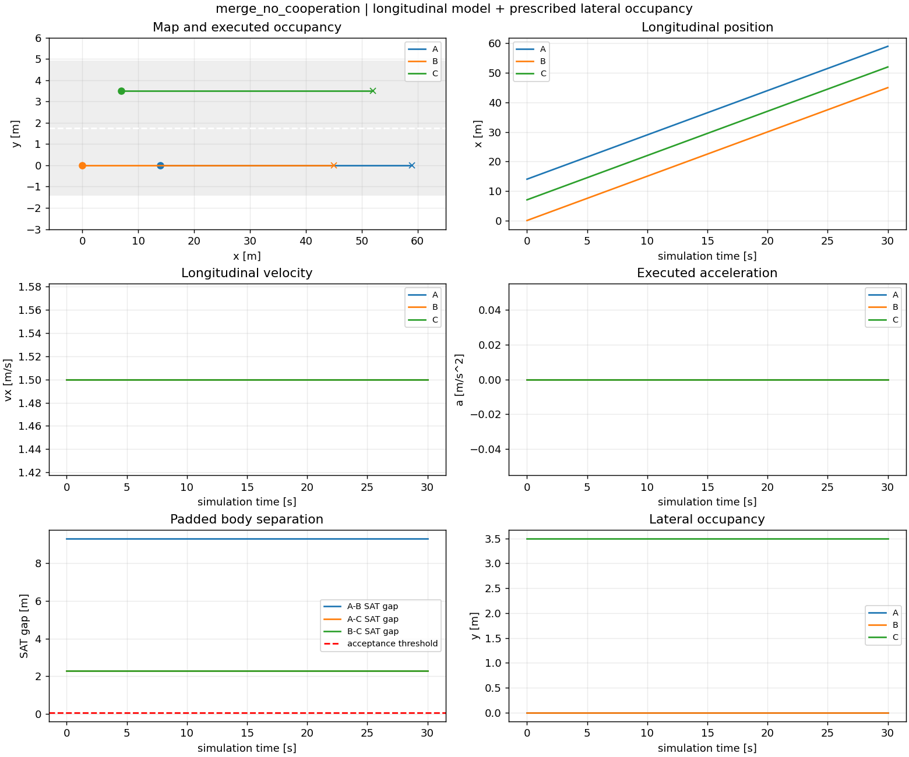
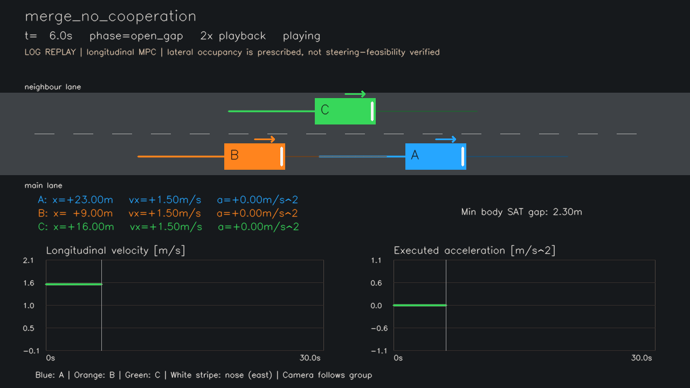

# 一次模拟日志总结：merge_no_cooperation

生成时间：2026-10-16T22:17:40.257116+08:00。本次报告、图片、视频及RViz2回放使用同一份原始执行日志。

## 1. 提交版本

运行时父仓库提交`75b27b621781a7e00800b00e6f8c7a1952d622a5`；提取目录尚待用户最终提交。该提交号不是新增merging代码已经提交的证明。实际执行源码指纹为`9e7c1c637e0a0be504fcc622bf83958cabd8876deee4bad5f3525bdaf01b6256`，逐文件SHA-256、依赖版本和实际命令见 [provenance.json](../provenance.json)。最终Git提交由用户完成，不能提前编造提交号。

## 2. 地图与初始条件

道路x∈[-20.0,250.0]m、y∈[-1.4,4.9]m。主道中心y=0.0m，邻道中心y=3.5m。三车均朝东、坐标原点为车身中心；含余量矩形车身4.7×2.0m。

初始(x,vx)：A=[14.0, 1.5]，B=[0.0, 1.5]，C=[7.0, 1.5]。主道A在B前方，C从邻道插入两者之间；目标顺序A-C-B。巡航速度1.5m/s；t=2.0s提出请求，横向动作持续6.0s；成功后至少观察到25.0s并检查车速恢复与最终顺序。精确输入见 [config.json](config.json)。

## 3. 控制周期、模型与优化

控制周期0.4s，16步/6.4s预测时域，执行与约束采样间隔0.1s。纵向状态[x,vx]，控制为加速度，采用精确零阶保持双积分。各车独立用SLSQP求解，提供解析梯度，只执行第一项，再以实际积分状态重新优化。

代价是2×巡航速度误差平方和 + 0.15×加速度平方和 + 0.2×相对于上一实际控制的加速度变化平方和。协作激活后，B和C另外加入1.2×跟驰间距误差平方和，期望中心间距为`4.7+0.5+0.8*v+1.8`m。整体缩放不改变最优解。

约束：0≤vx≤2.0m/s、|a|≤1.0m/s²；基础前车中心间距≥5.2m，协作跟驰激活后增加0.8s速度时距。请求后协作配置采用A→C→B虚拟前车链；不配合配置下B仍以前方A为约束对象，不主动为C开间距。

集中许可检查固定A-C-B顺序，在完整6.0s动作时域的31个时刻要求每对中心间距≥`length+margin+headway*v_behind+1.0`；不满足则C保持邻道。条件满足后用五次平滑函数预设横向占用，**未优化转角、未验证自行车换道可达性**。本例不是自主顺序协商或连续时间安全证明。

## 4. 通信设置

进程内同步全连接预测数据，每轮冻结上一轮收件箱；正常包龄0.4s、初始化包龄0。数据包含时间戳、绝对时间数组和x/vx/y预测；尾部补一周期零加速度以覆盖下一轮时域。没有丢包、抖动、实网传输或同周期迭代协商。每车求解只使用其当前指定前车的固定预测；`solves.json`保存前车身份及收到的时间戳。ROS用于后处理回放，不是本次控制通信通道。

## 5. 原始日志与图片

本次结果 **blocked**。许可时刻Nones，完成并线时刻Nones，总观察时长30.0s；B最低速度1.500000m/s；最小采样车身SAT间隙2.300000m；最大执行采样约束违背0；求解225次，拒绝0次。

`None`表示没有获得许可或完成并线。`blocked`表示指定策略和观察时间内并线未完成；负对照符合预期不等于并线成功，也不能证明所有策略均不可行。耗时依环境变化，不能据此宣称实时运行。

[实际执行 actual.csv](actual.csv) · [优化与前车记录 solves.json](solves.json) · [预测交换 predictions.jsonl](predictions.jsonl) · [许可检查 admission_checks.json](admission_checks.json) · [阶段事件 events.json](events.json) · [摘要 summary.json](summary.json)



## 6. RViz2 案例回放

按[README](../../../README.md)独立构建后：

```bash
ros2 launch merging_mpc replay.launch.py case:=merge_no_cooperation
```

默认加载随包安装的本次日志。可用`study_dir:=/absolute/path/to/run_001`切换结果，`playback_rate:=2.0`双倍速、`loop:=false`停止于最后。蓝色A、橙色B、绿色C，白条表示车头；粗线为已执行轨迹、细线为预测轨迹。两个案例的真实ROS发布订阅检查通过：三车末态、轨迹、状态标签和相机TF与日志一致。 当前环境无桌面，未将消息检查表述为已经检查GUI渲染画面。

## 7. 可播放视频

[打开或下载H.264 MP4](replay.mp4)，1280×720，20fps，2倍速，视频17.05s，包含结尾停留。已逐帧解码341帧，详见 [video.json](video.json)。视频从原始日志绘制，**不是RViz录屏**；它与RViz共用`recording.py`，相机随三车移动。

[](replay.mp4)

## 验证与完整性

六项离线测试退出码0，见[测试日志](../tests.log)。`verify_bundle.py`独立重放执行动力学、检查车身/道路/速度/加速度、重算全部许可决策、核对虚拟前车和包龄、重放预测控制并解码视频。源码与工件校验清单见[manifest.json](../manifest.json)，独立审计见[verification.json](../verification.json)（封存时生成）。
